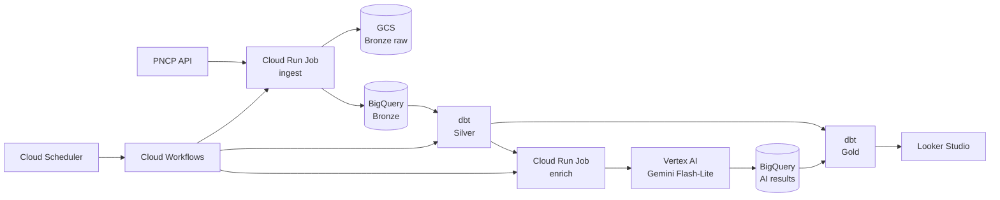

# PNCP Intelligent Data Pipeline

[](https://github.com/jmonteiroalves/pncp-data-pipeline/actions/workflows/ci.yml)

> An end-to-end batch data engineering project on Google Cloud that turns Brazil's public procurement notices into an analytics-ready, AI-enriched dataset.

**Status:** phase 1 — repository scaffold complete locally; ingestion not implemented; no cloud resources provisioned.

**Last updated:** 2026-11-17

---

## Why this project

Brazil publishes procurement notices through the **Portal Nacional de Contratações Públicas (PNCP)**. The portal centralises data from federal, state, and municipal agencies, but the purchase descriptions are free text: inconsistent, duplicated, and hard to analyse at scale.

This project builds a production-shaped pipeline that answers questions such as:

- How much is each government body spending by category (health, technology, transport, infrastructure)?
- Which categories are growing over time?
- Which agencies concentrate spending in each category?
- How reliable is an LLM-based classification of procurement descriptions?

The result is a public portfolio project that demonstrates data engineering fundamentals — ingestion, storage, modelling, quality, orchestration, infrastructure as code, cost control — with a focused, well-governed use of generative AI.

---

## What the pipeline does

1. **Ingests** procurement notices and contracts from the PNCP public API, incrementally and with rate-limit handling.
2. **Stores** the raw payload immutably in a Cloud Storage data lake (Bronze).
3. **Loads** raw records into BigQuery with ingestion metadata, preserving replayability.
4. **Transforms** data with dbt into typed, deduplicated, tested models (Silver).
5. **Enriches** a deterministic sample of purchase descriptions with Gemini, using structured JSON output, validation, caching, and prompt/model versioning.
6. **Publishes** star-schema facts, dimensions, and analytical marts (Gold) for dashboards.
7. **Operates** the pipeline with Cloud Scheduler, Cloud Workflows, Cloud Run Jobs, structured logs, alerts, and budget controls.
8. **Provisions** everything with Terraform and deploys through GitHub Actions using Workload Identity Federation.

---

## Design targets

These are targets, not measured results yet.

| Target | Value |
|---|---|
| Historical backfill | 90 days |
| Daily refresh | once per day, Gold available by 06:00 America/Sao_Paulo |
| Classification quality | macro-F1 ≥ 0.85 on a manually labelled golden set |
| LLM volume | up to 10,000 unique descriptions per month |
| Operational cost | ≤ US$ 10 per month, with budget alerts |
| Data freshness | Gold layer less than 26 hours old |
| Reproducibility | full stack provisioned from an empty project with Terraform |

---

## Architecture at a glance



A detailed design is in [docs/architecture.md](docs/architecture.md).

---

## Stack

| Layer | Technology | Why |
|---|---|---|
| Ingestion | Python + Cloud Run Jobs | Batch-friendly, container-based, scales to zero |
| Data lake | Cloud Storage | Cheap immutable raw storage, enables replay |
| Warehouse | BigQuery | Serverless, partitioned tables, free query tier |
| Transformation | dbt Core | Tested, documented, version-controlled SQL |
| AI enrichment | Vertex AI + Gemini 3.1 Flash-Lite | Lowest cost that met the quality gate, structured output, IAM-native |
| Orchestration | Cloud Scheduler + Cloud Workflows | Serverless, free-tier friendly, no cluster |
| Packaging | Docker | Reproducible jobs and local development |
| Infrastructure | Terraform | Repeatable, reviewable environments |
| CI/CD | GitHub Actions + Workload Identity Federation | No long-lived service account keys |
| BI | Looker Studio | Free, shareable dashboard for the portfolio |

---

## Data source

**Primary:** PNCP — API de Consulta (`https://pncp.gov.br/api/consulta`).

- Public, no authentication.
- National coverage mandated by Lei 14.133/2021.
- Incremental filters by publication date and last update date.
- Observed volume on a weekday: **3,996 procurement notices** and **6,061 contracts**.
- Observed constraint: HTTP **429** on request bursts, handled with ~1 request/second and backoff.

**Secondary (optional):** CATMAT/CATSER catalogue from Compras.gov.br, used only as a taxonomy reference. The item-level endpoint returned no records during validation, so it is not a dependency.

See [docs/data-source.md](docs/data-source.md) for the comparison, evidence, and licensing notes.

---

## Repository layout

```text
.
├── README.md
├── pyproject.toml
├── Makefile
├── Dockerfile
├── .env.example
├── .github/workflows/ci.yml
├── src/pncp_pipeline/
│   ├── __init__.py
│   ├── __main__.py
│   ├── cli.py
│   ├── config.py
│   ├── factory.py
│   ├── hashing.py
│   ├── log.py
│   ├── py.typed
│   ├── ingestion/            # pipeline, records, ports
│   ├── pncp/                 # API client and models
│   ├── storage/              # local and GCS Bronze writers
│   └── warehouse/            # SQLite and BigQuery loaders
├── tests/
├── scripts/                  # golden-set builder and utilities
├── evaluation/               # golden set template and 50-item pilot
├── dbt/                      # staging, intermediate and Silver models
├── infra/terraform/          # phase 6
└── docs/
```

---

## Local development

Prerequisites: Python 3.12+, `make`, and Docker (only for `make build`).

```bash
cp .env.example .env
make setup        # create .venv and install the package with dev dependencies
make lint         # ruff check, ruff format --check, mypy
make test         # pytest
make run-local    # print the resolved configuration
make dbt-build    # build and test the dbt models against BigQuery
make dbt-docs     # generate the dbt documentation site
make build        # build the container image
```

No Google Cloud credentials are required for local runs. The configuration has
safe local defaults and is validated at startup. Cloud access in later phases
will use Application Default Credentials and IAM, never keys.

If the local Python lacks `ensurepip`, `make setup` falls back to bootstrapping
pip with `get-pip.py`, which requires `curl`.

### Ingestion commands

```bash
# Smoke test: one day, one modality, two pages
python -m pncp_pipeline backfill \
  --start 2026-01-15 --end 2026-01-15 \
  --entity contratacoes --modality 6 --max-pages 2 --local

# Full day for one modality
python -m pncp_pipeline backfill \
  --start 2026-01-15 --end 2026-01-15 \
  --entity contratacoes --modality 6 --local

# Daily delta using the update endpoints
python -m pncp_pipeline delta \
  --entity contratacoes --modality 6 --window-days 0 --local

# Weekly sweep for late corrections
python -m pncp_pipeline delta --window-days 7 --local
```

Each command prints a JSON summary to stdout and structured logs to stderr.
Local runs write gzipped raw pages under `data/bronze/` and Bronze/control rows
to `data/local.db`. Re-running a window is idempotent: pages already loaded are
deduplicated by `record_id`, and completed days are skipped through checkpoints.

Without `--local`, the same commands write to Cloud Storage and BigQuery. They
require `GCP_PROJECT` and `GCS_BUCKET`, and the Bronze and Control datasets must
exist. Terraform provisions them in phase 6.

The dbt project is documented in [dbt/README.md](dbt/README.md). It reads from
`bronze` and writes tested Silver models to the `silver` dataset.

### Enrichment and evaluation

```bash
# Estimate tokens and cost without calling Gemini
python -m pncp_pipeline enrich --dry-run --limit 200 --sample-rate 1

# Classify a batch and store results in ai.classificacao
python -m pncp_pipeline enrich --limit 50 --batch-size 20

# Evaluate against the 50-item pilot golden set
python -m pncp_pipeline evaluate --golden-set evaluation/golden_set_pilot.csv

# Compare with the keyword baseline
python -m pncp_pipeline evaluate --golden-set evaluation/golden_set_pilot.csv --baseline
```

Enrichment writes to `ai.classificacao` and `control.llm_requests`. Results are
cached by description hash, prompt version, and model id, so re-runs do not pay
for the same text twice.

---

## Documentation

| Document | Purpose |
|---|---|
| [Architecture](docs/architecture.md) | Components, data flow, Medallion layers, quality, observability, security |
| [Data source](docs/data-source.md) | Candidate comparison, PNCP validation, data dictionary, collection plan |
| [Decisions](docs/decisions.md) | Architecture Decision Records and alternatives considered |
| [Cost estimation](docs/cost-estimation.md) | Assumptions, unit prices, monthly scenarios, cost controls |
| [Roadmap](docs/roadmap.md) | Phases, acceptance criteria, risks, deferred items |
| [Evaluation](evaluation/README.md) | Golden set files, pilot labels, metrics, and caveats |

---

## Status

- [x] Phase 0 — data source validation and architecture design
- [x] Phase 1 — repository scaffold, Docker (269 MiB), local tooling and CI (green)
- [x] Phase 2 — ingestion and Bronze layer (validated locally and against GCS/BigQuery)
- [x] Phase 3 — Silver models with dbt
- [x] Phase 4 — LLM enrichment and evaluation (50-item pilot; full 300-label review pending)
- [ ] Phase 5 — Gold marts and dashboard
- [ ] Phase 6 — Terraform and CI/CD
- [ ] Phase 7 — observability and cost controls

Portfolio site integration is intentionally deferred until the three planned data engineering projects are complete.

---

## Non-goals

- Real-time or streaming ingestion. The source is published in batches and daily refresh is sufficient.
- Using an LLM for deterministic work such as parsing dates, normalising currency, deduplicating records, or deriving geographic keys.
- Redistributing raw PNCP payloads. Only derived and aggregated data will be published.
- Processing personal data. Descriptions are masked for CPF, phone numbers, and e-mail before any LLM call.

---

## License and attribution

- Code license: to be defined before publication (MIT suggested).
- Data: PNCP / gov.br. The project will attribute the source and publish only derived data.
- The PNCP site content is published under CC BY-ND 3.0; the underlying procurement data is public under Lei 14.133/2021 and access-to-information rules.
