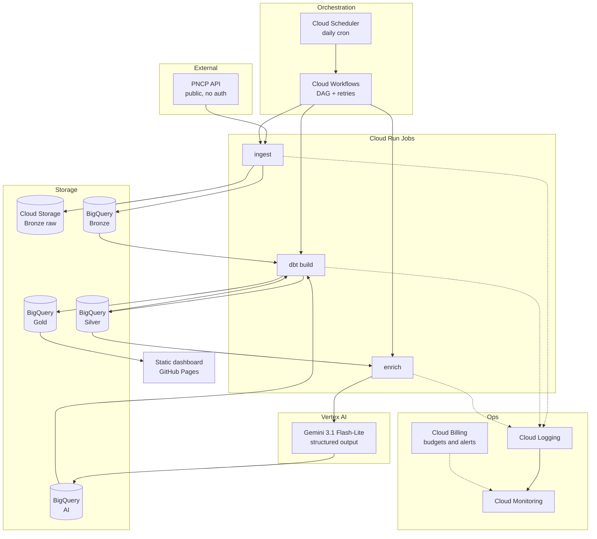

# Architecture

**Status:** proposed and approved for implementation
**Last updated:** 2026-11-17

---

## 1. Purpose and scope

This document describes the architecture of a batch pipeline that ingests Brazilian public procurement data from the PNCP API, stores it using a Medallion model on Google Cloud, transforms it with dbt, enriches purchase descriptions with Gemini on Vertex AI, and publishes analytical marts.

The design is optimised for:

- low operational cost and scale-to-zero;
- batch processing, not streaming;
- reproducibility and auditability;
- a clear separation between deterministic transformations and probabilistic enrichment.

Out of scope for the first version: real-time ingestion, item-level procurement data, streaming, and a public API for third-party consumers.

---

## 2. Design principles

1. **Raw data is immutable.** Every payload is written to Cloud Storage before any transformation. BigQuery can always be rebuilt from the lake.
2. **Deterministic before probabilistic.** Parsing, typing, deduplication, normalisation, and joins are done in Python/SQL. The LLM only classifies free text.
3. **Everything is idempotent.** Re-running a job must not duplicate rows or duplicate LLM spend.
4. **Every output is traceable.** Rows carry ingestion, run, model, and prompt identifiers.
5. **Cost is a design constraint.** Partitioning, clustering, caching, sampling, and limits are part of the architecture, not an afterthought.
6. **Serverless only.** No clusters, no always-on VMs, no managed databases.

---

## 3. Context diagram



---

## 4. Component responsibilities

| Component | Responsibility | Configuration |
|---|---|---|
| Cloud Scheduler | Triggers the daily workflow | `0 3 * * *`, `America/Sao_Paulo` |
| Cloud Workflows | Sequences jobs, applies retries, stops on failure | One workflow, internal steps only |
| Cloud Run Job `ingest` | Paginates the PNCP API, writes raw files, loads BigQuery Bronze | 1 vCPU, 1 GiB, timeout 3,600 s, task count 1 |
| Cloud Run Job `dbt` | Runs `dbt build` for Silver and Gold | 1 vCPU, 1 GiB, timeout 1,800 s |
| Cloud Run Job `enrich` | Selects pending descriptions, calls Gemini, validates and stores results | 1 vCPU, 1 GiB, timeout 1,800 s |
| Cloud Storage | Immutable Bronze layer and replay source | `us-central1`, uniform access, lifecycle 180 days |
| BigQuery | Bronze, Silver, AI, Gold, and Control datasets | `US` multi-region |
| Vertex AI | Semantic classification | Gemini 3.1 Flash-Lite, global endpoint, temperature 0 |
| Artifact Registry | Container images | `us-central1`, cleanup policy for old tags |
| Cloud Logging | Structured application logs | JSON logs, 30-day retention |
| Cloud Monitoring | Metrics, alerts, dashboards | Log-based metrics and uptime checks |
| Cloud Billing | Budget and spend alerts | US$ 10 budget, alerts at 50%, 90%, 100% |
| Static dashboard | Public portfolio view | Chart.js on GitHub Pages; data exported from Gold marts |
| Terraform | Provisions all resources | Remote state in GCS, per-environment workspaces |
| GitHub Actions | Lint, test, build, plan, apply, deploy | Workload Identity Federation, no keys |

---

## 5. End-to-end data flow

### Daily run

1. **03:00 BRT** — Cloud Scheduler invokes the workflow with an OIDC token.
2. **Workflow** starts the `ingest` job.
3. **Ingest** reads watermarks from `control.watermarks`.
4. For each configured PNCP modality, it calls `/v1/contratacoes/atualizacao` from the last successful date (1-day overlap) to today.
5. Pages are fetched at ~0.8 requests/second; HTTP 429 triggers exponential backoff with jitter.
6. Each page is written as a `.jsonl.gz` object whose name includes a content hash; the run id is stored as object metadata.
7. The same run also fetches `/v1/contratos/atualizacao` for the same window.
8. The page is loaded into a staging table and MERGEd into Bronze on `(source_date, record_id)`.
9. The ingest job records row counts and finishes; the workflow starts the `dbt` job.
10. **dbt** rebuilds staging and Silver models with `merge` incremental logic, then runs tests.
11. If Silver tests pass, the workflow starts the `enrich` job.
12. **Enrich** selects unique, sampled descriptions that are not in the cache, builds batches of 20, calls Gemini with a JSON schema, validates the response, and appends valid results to `ai.classificacao`.
13. **dbt** runs again for Gold models, joining Silver facts to the latest valid classification, then runs tests.
14. **Workflow** completes; `control.ingestion_runs` holds status, counts, duration, and errors.

### Backfill run

A separate manual invocation uses `/v1/contratacoes/publicacao` day by day for
the 90-day window. It records a checkpoint per date and modality in
`control.ingestion_checkpoints` after the day completes, so an interrupted job
resumes on the next incomplete day. A crash mid-day re-fetches that day;
`record_id` deduplication prevents duplicate Bronze rows.

Backfill and daily runs share the same writer and deduplication rules.

---

## 6. Medallion layers

### Bronze — fidelity and replay

**Storage:** Cloud Storage + native BigQuery tables.

- One object per API page, compressed JSON Lines.
- Immutable: never edited or deleted by the pipeline.
- Contains the exact API payload plus request metadata.
- Lifecycle: raw GCS objects expire after 180 days. BigQuery Bronze is retained for audit; partition expiration is not used because partitions follow the business date, not the ingestion date.
- Purpose: rebuild Silver/Gold, investigate incidents, and prove what the source returned on a given date.

**GCS layout:**

```text
gs://<project>-pncp-lake/
  bronze/pncp/contratacoes/dt=2026-01-15/modality=6/page=0001-13f9a89111c1.jsonl.gz
  bronze/pncp/contratos/dt=2026-01-15/page=0001-5c2d7b9a44f0.jsonl.gz
  quarantine/...
```

The page key is a content hash, so identical pages produce identical object
names and re-uploads are skipped with a generation precondition. The run id is
stored as object metadata and in every Bronze row.

**BigQuery Bronze columns:**

| Column | Type | Description |
|---|---|---|
| `ingestion_id` | STRING | UUID of the ingest run |
| `source` | STRING | Always `pncp` |
| `entity` | STRING | `contratacoes` or `contratos` |
| `endpoint` | STRING | API path used |
| `request_params` | JSON | Date window, modality, page, page size |
| `page` | INT64 | Page number |
| `record_index` | INT64 | Position of the record inside the page |
| `page_key` | STRING | SHA-256 of endpoint, params, page and content |
| `gcs_uri` | STRING | Raw object that contains this record |
| `record_id` | STRING | SHA-256 of entity and canonical record |
| `record_hash` | STRING | SHA-256 of the canonical record |
| `source_date` | DATE | Publication date from the payload |
| `api_status` | INT64 | HTTP status |
| `payload` | JSON | Raw record |
| `ingested_at` | TIMESTAMP | Ingestion timestamp |

Partitioned by `source_date`, clustered by `entity, endpoint`. The loader MERGEs
on `(source_date, record_id)`, which makes re-runs idempotent without scanning
the whole table.

### Silver — typed, deduplicated, conformed

- Parses nested JSON into typed columns.
- Normalises dates, currency, CNPJ, UF, and municipality codes.
- Removes duplicate records by natural key, keeping the most recent payload.
- Produces `contratacoes`, `contratos`, conformed dimensions, and a history table.
- Rejects invalid rows to `silver._quarantine` with a reason.
- Purpose: a trustworthy, query-friendly representation of the source.

### AI — classification and audit

- Append-only results, never overwritten in place.
- One row per `(description_hash, prompt_version, model_id)`.
- Holds the category, confidence, justification, token usage, latency, and validation status.
- Purpose: reproducibility, cost accounting, and comparison between prompt/model versions.

### Gold — analytics-ready

- Star schema: `fato_contratacao`, `fato_contrato`, and conformed dimensions.
- One row per procurement notice or contract.
- Joins the latest valid AI classification.
- Analytical marts aggregated by category, agency, state, and time.
- Purpose: dashboards and portfolio storytelling.

### Control — operations

Phase 2 implements:

- `ingestion_runs` — one row per ingestion invocation, with counts and errors.
- `ingestion_checkpoints` — completed days by entity and modality.
- `watermarks` — last successful update date per entity.

Phase 4 adds `llm_requests`; phase 7 adds `data_quality_results`. Purpose:
observability, restartability, and cost tracking.

### Data model summary

**Grain and keys**

- `fato_contratacao`: one row per `numero_controle_pncp`.
- `fato_contrato`: one row per contract `numero_controle_pncp`.
- Dimensions use natural keys where they exist (CNPJ, IBGE code, modality code) and surrogate keys otherwise.

**`silver.contratacoes`**

| Column | Type | Notes |
|---|---|---|
| `numero_controle_pncp` | STRING | Primary key |
| `cnpj_orgao` | STRING | Agency CNPJ |
| `razao_social` | STRING | Agency name |
| `esfera` | STRING | Federal, state, municipal |
| `poder` | STRING | Executive, legislative, judiciary |
| `uf` | STRING | State |
| `municipio` | STRING | Municipality name |
| `codigo_ibge` | STRING | IBGE municipality code |
| `codigo_unidade` | STRING | Organisational unit |
| `modalidade_id` | INT64 | Modality code |
| `modalidade_nome` | STRING | Modality name |
| `modo_disputa_id` | INT64 | Dispute mode |
| `objeto_compra` | STRING | Original description |
| `objeto_normalizado` | STRING | Normalised description used for hashing |
| `valor_estimado` | NUMERIC | Estimated value |
| `valor_homologado` | NUMERIC | Awarded value, nullable |
| `data_publicacao` | TIMESTAMP | Publication |
| `data_abertura` | TIMESTAMP | Proposal opening |
| `data_encerramento` | TIMESTAMP | Proposal closing |
| `srp` | BOOL | Price registry flag |
| `situacao` | STRING | Notice status |
| `amparo_legal_codigo` | INT64 | Legal basis |
| `link_processo` | STRING | Source process link |
| `data_atualizacao_global` | TIMESTAMP | Source update timestamp |
| `hash_registro` | STRING | Hash of the canonical record |
| `source_run_id` | STRING | Ingestion run |
| `ingested_at` | TIMESTAMP | Load timestamp |
| `valid_from` | TIMESTAMP | SCD2 start, if snapshots are enabled |
| `valid_to` | TIMESTAMP | SCD2 end |
| `is_current` | BOOL | Current version flag |

**`silver.contratos`**

Key columns: `numero_controle_pncp`, `numero_controle_compra`, `cnpj_orgao`, `razao_social`, `fornecedor_ni`, `fornecedor_nome`, `objeto_contrato`, `valor_inicial`, `valor_global`, `valor_acumulado`, `data_assinatura`, `vigencia_inicio`, `vigencia_fim`, `data_publicacao`, `hash_registro`, `source_run_id`, `ingested_at`.

**Dimensions**

`dim_orgao` (CNPJ, name, sphere, power, state, municipality), `dim_unidade` (unit code, name, agency), `dim_modalidade` (code, name), `dim_tempo` (date, year, month, week, weekday), `dim_categoria` (category, subcategory, taxonomy version).

**`ai.classificacao`**

`enrichment_id`, `description_hash`, `description`, `categoria`, `subcategoria`, `tipo_objeto`, `confianca`, `justificativa`, `model_id`, `prompt_version`, `prompt_hash`, `taxonomy_version`, `temperature`, `request_id`, `latency_ms`, `validation_status`, `validation_errors`, `created_at`.

Request-level tokens, latency, and estimated cost live in `control.llm_requests`.

**`gold.fato_contratacao`**

Foreign keys to `dim_tempo`, `dim_orgao`, `dim_unidade`, `dim_modalidade`, and `dim_categoria`; measures `valor_estimado`, `valor_homologado`; degenerate keys `numero_controle_pncp` and `link_processo`; flags `tem_classificacao` and `srp`.

**Marts**

`agg_gastos_categoria` (month, category, notices, estimated value, awarded value), `agg_orgaos` (agency, category, total, rank), `agg_tendencias` (month, category, moving average), `agg_cobertura_ia` (month, classified, total, coverage rate).

**`control`**

`ingestion_runs` (`run_id`, `mode`, `entity`, `start_date`, `end_date`, `status`, `page_count`, `record_count`, `started_at`, `finished_at`, `error_message`), `ingestion_checkpoints` (`entity`, `extraction_date`, `modality`, `last_page`, `updated_at`), `watermarks` (`entity`, `last_successful_date`, `updated_at`). `llm_requests` and `data_quality_results` arrive in phases 4 and 7.

---

## 7. Ingestion design

### Source endpoints

| Purpose | Endpoint | Page limit |
|---|---|---|
| Backfill by publication date | `GET /v1/contratacoes/publicacao` | 50 |
| Daily delta by update date | `GET /v1/contratacoes/atualizacao` | 50 |
| Contracts backfill | `GET /v1/contratos` | 500 |
| Contracts daily delta | `GET /v1/contratos/atualizacao` | 500 |

All requests are unauthenticated. Dates use `YYYYMMDD`. An empty result is returned as HTTP 204.

### Rate limiting

- Client-side token bucket at **0.8 requests/second**, one worker.
- On HTTP 429: exponential backoff of roughly 2, 4, 8, 16, and 32 seconds with jitter, maximum 5 attempts.
- On HTTP 5xx and timeouts: same backoff, maximum 5 attempts.
- On HTTP 204: stop paginating and mark the day as complete.
- Each retry is logged with the endpoint, page, attempt, and wait time.
- Concurrency stays at 1. Parallel workers made the 429 rate worse in tests.

Observed during validation on 2026-11-17: a 24-page backfill of one day and
modality completed in about two minutes; a 118-page delta was still being
throttled after ten minutes, with 429s at pages 8 and 111. Retries recovered,
but long runs must budget for throttling and use the 60-minute job timeout.

### Checkpointing and idempotency

- Checkpoint key: `entity + extraction_date + modality`, with the last completed page stored.
- Written after a day and modality finish successfully. If the job crashes mid-day, that day is re-fetched; deduplication prevents duplicate rows.
- Bronze loads are idempotent through a `MERGE` on `(source_date, record_id)`.
- `record_id` is a content hash, so the same API record always maps to the same row.
- A re-run of the same date does not duplicate Bronze rows.
- Watermarks only advance after the delta window completes without truncation.

### Incremental window

- Daily delta starts at the last successful date (a 1-day overlap) and runs to today.
- The update endpoint is heavier than the publication endpoint: a 3-day window for one modality returned 5,886 notices in validation. A weekly 7-day sweep catches late corrections without paying for that volume every day.
- Backfill is bounded to 90 days for the demo.
- Each modality is ingested independently, so a failure in one does not block the others.

---

## 8. Transformation with dbt

### Project structure

```text
dbt/
├── dbt_project.yml
├── profiles.yml         # ADC + environment variables
├── models/
│   ├── staging/pncp/    # stg_pncp__contratacoes, stg_pncp__contratos
│   ├── intermediate/    # int_contratacoes_dedup, int_contratos_dedup
│   └── marts/           # contratacoes, contratos, dim_*, quarantine_*
├── tests/               # singular tests
└── macros/              # generate_schema_name
```

The `ai` models and the Gold analytical marts arrive in phases 4 and 5.

### Materialisations

| Layer | Materialisation | Reason |
|---|---|---|
| Staging | View | No storage cost, always current |
| Intermediate | Table | Deduplicated once per build |
| Silver entities | Incremental `merge` | Efficient daily updates by natural key |
| Dimensions | Table | Small and stable |
| Analytics marts | Table | Dashboard performance |

### Conventions

- Staging uses `stg_`, intermediate uses `int_`, dimensions use `dim_`; Silver entities keep their domain names. Gold facts will use `fct_`.
- Every model has a description and column documentation.
- Surrogate keys are generated with `GENERATE_UUID()` only where a natural key does not exist.
- Natural keys: `numero_controle_pncp` for notices and contracts.
- Monetary values use `NUMERIC`.
- Timestamps are stored in UTC; dashboards convert to America/Sao_Paulo.

---

## 9. AI enrichment architecture

### Placement

Enrichment runs **after Silver** and **before Gold**. The job reads from `silver.contratacoes`, writes to `ai.classificacao`, and dbt joins the latest valid result into Gold.

### Selection

1. Normalise the description: trim, collapse whitespace, remove platform prefixes such as `[Portal de Compras Públicas] -`, fix encoding.
2. Hash the normalised text.
3. Remove descriptions already present in the cache for the same prompt and model.
4. Apply deterministic sampling by hash and a monthly cap of 10,000 items.
5. Order by hash for reproducibility.

### Batching and output

- 20 descriptions per request.
- Each item carries a 16-character `id` derived from the hash.
- `temperature = 0`.
- `responseSchema` enforces an array of objects with `id`, `categoria`, `subcategoria`, `tipo_objeto`, `confianca`, and `justificativa`.
- The response is rejected if the returned id set differs from the sent id set.

### Scope of extraction

Version 1 extracts only:

- `categoria` and optional `subcategoria` (controlled vocabulary);
- `tipo_objeto` (`bem`, `servico`, `obra`, `desconhecido`);
- a short `justificativa` for auditability.

Broader entity extraction — supplier names, brands, quantities, model numbers — is deliberately out of scope. Those entities are partially available in deterministic fields (agency, unit, geography, values), and extracting them from free text would require a larger schema, more validation rules, and more tokens per item. It is recorded as a deferred item.

### Validation and failure handling

| Check | Action on failure |
|---|---|
| Valid JSON | Retry once with a repair prompt |
| Schema conformance | Retry once, then mark failed |
| Category in enum | Retry once, then mark failed |
| Confidence between 0 and 1 | Reject and repair |
| Id set equality | Retry once, then mark failed |
| Duplicate ids | Retry once, then mark failed |
| `tipo_objeto` in enum | Retry once, then mark failed |
| Justification length | Reject and repair |

Failed records are stored with `validation_status = 'failed'` and excluded from Gold until retried.

### Cache and spend control

- Cache key: `SHA256(normalised_text, prompt_version, model_id)`.
- A result from another prompt or model version is not reused.
- Limits: `--limit`, `--batch-size`, `LLM_MONTHLY_CAP`, `max_output_tokens`.
- A dry-run mode calculates request counts and token estimates without calling the API.
- Every request is recorded in `control.llm_requests` with tokens, latency, and estimated cost.

### Model selection

The first evaluation used Gemini 3.5 Flash-Lite. A cost/quality comparison on
the pilot set showed that Gemini 3.1 Flash-Lite met the quality gate at a lower
price, so the default is now `gemini-3.1-flash-lite`:

| Model | Pilot macro-F1 | Cost per 1,000 items |
|---|---:|---:|
| Gemini 3.5 Flash-Lite | 0.874 | ~US$ 0.27 |
| Gemini 3.1 Flash-Lite | 0.865 | ~US$ 0.17 |

The 3.5 result remains in the AI table under its own `model_id`; evaluations
filter by model and prompt version.

### Evaluation

- `evaluation/golden_set.csv`: 300 sampled descriptions with empty labels for the owner to review.
- `evaluation/golden_set_pilot.csv`: 50 pilot labels, marked as pending owner review.
- Metrics: accuracy, macro-F1, per-category precision/recall/F1, confusion matrix.
- Baseline: transparent keyword rules, measured on the same pilot.
- Pilot result: macro-F1 **0.865** versus **0.656** for the keyword baseline.
- Release gate: macro-F1 ≥ 0.85. The pilot passes; the full 300-label review is still pending.
- Monthly review of 50 random classifications.

---

## 10. Data quality

### dbt tests

- `unique` and `not_null` on natural keys.
- `accepted_values` on modality, UF, and category.
- `relationships` between facts and dimensions.
- `not_null` on dates and agency identifiers.
- Custom tests for CNPJ format, non-negative values, and valid date ranges.

### Pipeline checks

- Row count compared with the 7-day median; alert if outside ±3 standard deviations.
- Duplicate rate in Silver must stay below 1%.
- Null rate for `objeto_compra` must stay below 2%.
- Freshness: Gold must be updated within 26 hours.
- Quarantine rate must stay below 1% of ingested rows.
- LLM invalid-response rate must stay below 1%.

### Quarantine

Rows that fail structural validation are written to `silver._quarantine` with `reason`, `payload`, and `run_id`. They do not block the pipeline and are reviewed manually.

---

## 11. Orchestration

```text
Cloud Scheduler
  └── Cloud Workflows
        ├── run ingest job (retry 2x)
        ├── run dbt job --select staging silver (retry 1x)
        ├── run enrich job (retry 1x, non-blocking on partial failures)
        ├── run dbt job --select gold (retry 1x)
        └── record pipeline result
```

- Workflows uses connector calls to the Cloud Run Admin API.
- Each step has an explicit timeout.
- A failure in ingestion or Silver stops the run and triggers an alert.
- A partial enrichment failure does not block Gold; unclassified records fall back to `Outros` and are queued for the next run.
- The workflow is versioned in Terraform alongside the jobs.

---

## 12. Observability

### Logs

Structured JSON with `severity`, `run_id`, `job`, `step`, `source`, `endpoint`, `page`, `rows`, `duration_ms`, and `error`.

### Metrics

- `ingestion_runs_total{status}`
- `ingestion_rows_total{entity}`
- `ingestion_http_429_total`
- `dbt_tests_failed_total`
- `llm_requests_total{status}`
- `llm_tokens_total{type}`
- `llm_cost_usd_total`
- `gold_freshness_hours`

### Alerts

| Alert | Condition | Severity |
|---|---|---|
| Job errors | Any `ERROR` log from a Cloud Run job, 5-minute window | Error |
| 429 storm | More than 10 rate-limit retries in 15 minutes | Warning |
| Invalid LLM responses | Any invalid structured response in 30 minutes | Warning |
| No fresh data | `pncp_delta_ingested` metric absent for 23h30m (the maximum allowed absence window) | Error |
| Budget threshold | Billing account budget at 50%, 90%, 100% (manual guardrail) | Warning/Page |

### Dashboards

- **Operations:** Cloud Monitoring dashboard `PNCP operations` with error logs, 429 retries, invalid LLM responses, and delta windows.
- **Operations snapshot:** static `dashboard/ops.html` with recent runs, rows, LLM tokens, cost, and errors.
- **Business:** static `dashboard/index.html` with category spend, daily evolution, top agencies, state coverage, and AI coverage.

---

## 13. Security and IAM

### Service accounts

| Account | Permissions |
|---|---|
| `sa-pncp-ingest` | `storage.objectCreator` on the lake bucket, `bigquery.dataEditor` on Bronze, `bigquery.jobUser` |
| `sa-pncp-dbt` | `bigquery.dataEditor` on Silver and Gold, `bigquery.jobUser` |
| `sa-pncp-enrich` | `bigquery.dataViewer` on Silver, `bigquery.dataEditor` on AI, `bigquery.jobUser`, `aiplatform.user` |
| `sa-pncp-orchestrator` | `run.jobs.run` on the three jobs, `workflows.invoker` |
| `sa-github-deploy` | Federated identity, Artifact Registry writer, Cloud Run deploy, Terraform permissions |

### Controls

- No service account keys. GitHub Actions uses Workload Identity Federation.
- No public buckets.
- Uniform bucket-level access enabled.
- BigQuery datasets are private; access is granted per group.
- Vertex AI calls use the attached service account, not an API key.
- Personal data patterns (CPF, phone, e-mail) are masked before any LLM request.

---

## 14. Failure modes and recovery

| Failure | Detection | Recovery |
|---|---|---|
| PNCP 429 | HTTP status and metrics | Backoff; resume from checkpoint |
| PNCP 5xx or timeout | HTTP status | Retry; if persistent, fail the run and alert |
| Schema drift | dbt test or parse error | Quarantine row; update extractor; replay from GCS |
| Partial load | Row counts vs API total | Re-run the partition; MERGE prevents duplicates |
| dbt test failure | dbt exit code | Stop Gold; alert; fix and re-run |
| Invalid LLM JSON | Validation status | Repair prompt; then mark failed and retry next run |
| Vertex quota or outage | API error | Skip enrichment; Gold uses `Outros`; retry next day |
| Job killed without SIGTERM | Run row stays `running` | Phase 7 reconciliation; checkpoints prevent data loss |
| Budget threshold | Billing alert | Disable enrichment, keep ingestion and dbt running |
| Image regression | CI tests or deploy health | Roll back to the previous Artifact Registry tag |

Every recovery path is documented in [runbook.md](runbook.md).

---

## 15. Environments and configuration

| Environment | Purpose | Project |
|---|---|---|
| `dev` | Local and integration tests | `pncp-pipeline-dev` |
| `prod` | Demo and portfolio | `pncp-pipeline-prod` |

Configuration is injected through environment variables:

```text
GCP_PROJECT
BQ_LOCATION=US
GCS_BUCKET
PNCP_BASE_URL=https://pncp.gov.br/api/consulta
PNCP_REQUEST_INTERVAL_SECONDS=1.25
PNCP_MAX_RETRIES=5
PNCP_PAGE_SIZE=50
PNCP_CONTRACT_PAGE_SIZE=500
PNCP_TIMEOUT_SECONDS=60
PNCP_MODALITIES=1,4,5,6,7,8,9,10,11,12
GCS_PREFIX=bronze/pncp
BRONZE_DATASET=bronze
CONTROL_DATASET=control
LOCAL_DATA_DIR=data
LLM_MODEL=gemini-3.1-flash-lite
LLM_PROMPT_VERSION=v1
LLM_TAXONOMY_VERSION=v1
LLM_BATCH_SIZE=20
LLM_MONTHLY_CAP=10000
LLM_MONTHLY_BUDGET_USD=10
```

No secrets are required. Access is granted through IAM and ADC.

---

## 16. Capacity and limits

| Item | Expected | Limit |
|---|---|---|
| Notices per day | ~4,000 | 50 per page, ~80 pages |
| Contracts per day | ~6,000 | 500 per page, ~12 pages |
| Observed page latency | 1–6 s local; ~18 s cloud with per-page load/MERGE | Batch loads per day before deployment |
| Daily delta, all modalities | 20–50 min | 60 min; split by modality if needed |
| 3-day delta, one modality | 118 pages, over 10 min under throttling | Split or increase timeout |
| 7-day backfill, all modalities | 381 pages observed, 31 min | Split into 3-day chunks if slower |
| Bronze size after 90 days | ~2 GB raw | GCS lifecycle 180 days |
| BigQuery logical storage | ~5 GiB | 10 GiB free tier |
| LLM items per month | 10,000 | Monthly cap |
| LLM requests per month | ~500 | 20 items per batch |
| Dashboard queries | < 50 GB scanned per month | 1 TiB free tier |

If the backfill needs more than 60 minutes, split it into 3-day chunks or run
it as a separate job with a 24-hour timeout. The API throttles aggressively on
long runs, so the effective page latency must be measured, not assumed.

---

## 17. Deferred items

- Item-level procurement data (the Compras.gov.br endpoint returned no records during validation).
- CATMAT/CATSER deterministic pre-classification.
- Vertex AI Batch API for a 50% discount.
- Embeddings or clustering for description deduplication.
- SCD2 snapshots for contracts.
- Public API or data export for third parties.
- Multi-language taxonomy.

---

## 18. Related documents

- [Data source](data-source.md)
- [Decisions](decisions.md)
- [Cost estimation](cost-estimation.md)
- [Roadmap](roadmap.md)
